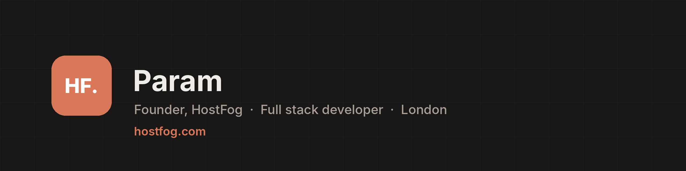

  

  
  
  
  

## About

I'm the founder of **[HostFog Ltd](https://hostfog.com)**, a London software
company making the tools people use to build, host and run websites. I've been
a full stack developer since 2018, and I lead HostFog's products from the
server engine to the screen.

We build for the long term: software people can trust, kept simple, and solid
enough to run for the next 20 years.

## Products

| Product | What it does |
| --- | --- |
| **[HF Panel](https://hostfog.com)** | Web hosting control panel for Linux servers. Server Admin, Reseller and Control Panel, with Mail, Files, DB Studio and a full API. |
| **[HF Local](https://hostfog.com/software/)** | Free desktop app for building websites on your own computer. Windows, macOS and Linux. |
| **[HF Connect](https://hostfog.com/software/)** | Free SSH, SFTP and FTP client in one window. |
| **[HF Tunnel](https://hostfog.com/software/)** | Puts a site on your computer online in one click at `name.hostfog.io`. Free, no account. |

## Open source

| Project | Description | Language |
| --- | --- | --- |
| **[hfee](https://github.com/hostfog/hfee)** | Run AI models on your own machine. A pure-Go inference engine with no dependencies. | Go |
| **[hfee-ai](https://github.com/hostfog/hfee-ai)** | Self-hosted AI assistant: chat, files, search, images and voice, on servers, desktops and phones. | JavaScript |
| **[hfkv](https://github.com/hostfog/hfkv)** | Fast key-value and cache server that speaks the Redis protocol. | Go |

All MIT licensed. Issues and pull requests are welcome.

## Roadmap

- **HF Cloud**: virtual servers, managed from HF Panel
- **HF Deploy**: push to Git and your app is live
- **HF Builder**: design and build Android and iOS apps
- **Sigil**: a complete JWT library for Go

## Technology

  
  
  
  
  
  
  
  
  

---

  HostFog Ltd · London, United Kingdom · <a href="https://hostfog.com">hostfog.com</a>

